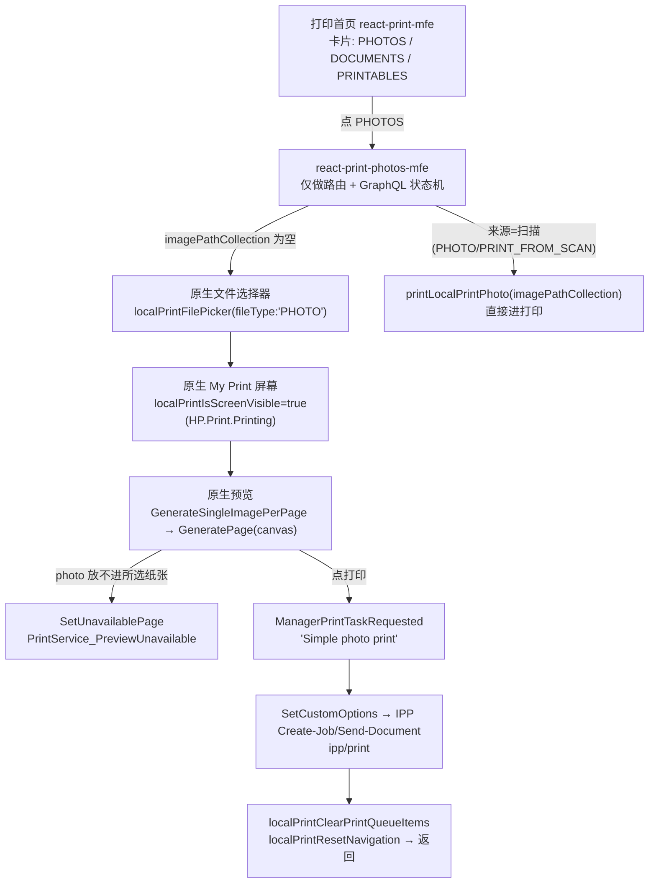

# myHP（新版 HP 应用）图片打印全流程逆向

> 只读逆向。目标：新版 myHP `61.52637.14262.0`（React + WebView2）+ 原生宿主，回答「点打印照片 → 出纸」之间到底发生了什么，并定位「打出来更亮」的根因。
>
> 结论先行：**新版 myHP 的照片打印 UI 与 IPP 组包全部在原生侧（.NET / HP.HPX.dll），React MFE 只负责路由、文件选择与 GraphQL 状态机。** 因此只看 JS 会得出「HP 没有打印选项」的错误结论；真正的选项模型在 `HP.Print.Printing\Assets\translations.json` + `HP.HPX.dll` 的 `PrintServiceImplementation` 里。

---

## 0. 证据路径速查

下文用短名引用，全部为绝对路径：

| 短名 | 绝对路径 |
|---|---|
| `PHOTOS_MFE` | `C:\Program Files\WindowsApps\AD2F1837.myHP_61.52637.14262.0_x64__v10z8vjag6ke6\Weblets\webapps\root-web-mfe\assets\mfe\@hpx-core-experiences\react-print-photos-mfe\hpx-core-experiences-react-print-photos-mfe.js`（54,138 B，minified 3 行） |
| `DOCS_MFE` | `...\react-print-documents-mfe\hpx-core-experiences-react-print-documents-mfe.js`（61,036 B） |
| `PRINT_MFE` | `...\react-print-mfe\hpx-core-experiences-react-print-mfe.js`（229,037 B，打印首页卡片） |
| `NB_API` | `...\@clientos\commons-northbound-api\clientos-commons-northbound-api.js`（1,698,899 B） |
| `TRANSLATIONS` | `C:\Program Files\WindowsApps\AD2F1837.myHP_61.52637.14262.0_x64__v10z8vjag6ke6\HP.Print.Printing\Assets\translations.json`（118,399 chars，55 个 key） |
| `HPX` | `C:\Program Files\WindowsApps\AD2F1837.myHP_61.52637.14262.0_x64__v10z8vjag6ke6\HP.HPX.dll`（215,572,184 B，含全部 HP.Print.* / IPP 托管代码与字符串） |
| `LOCALE` | `...\react-print-photos-mfe\assets\locale\zh_CN.json` / `en_US.json` |

`HPX` 中的字符串为 UTF-16LE，通过 `[Text.Encoding]::Unicode.GetString([IO.File]::ReadAllBytes($f))` 提取，命中位置（字符偏移）在下文标注为 `@offset`，可复现。

---

## 1. UI 流程：从「打印照片」到出纸

### 1.1 页面链路



### 1.2 逐步证据

**① 打印首页**（`PRINT_MFE`）是卡片枢纽，不是选项页。字符串池中可见卡片常量与图标：

```
PHOTOS   PhotosIcon
DOCUMENTS  DocumentsIcon
PRINTABLES
"MFE package for print details layout"
"usePrintContext must be used within a PrintProvider"
```

**② 照片 MFE 受 LaunchDarkly 开关控制**（`PHOTOS_MFE` @53818）：

```js
return It.default.v1.useToggle(r.default,{key:"printer-x-localprint"})
  && (0,wt.jsx)(c,{client:a,children:(0,wt.jsx)(ut,{children:(0,wt.jsx)(Preview,{})})})
```

即：`printer-x-localprint` 关闭时，新版照片打印根本不渲染（回落到 HP Smart / PSAmigration 路径，见 `solution-hpx-react-print_psamigration-mfe`）。

**③ 照片 MFE 的全部能力 = 5 个 GraphQL 字段 + 5 个 mutation**（`PHOTOS_MFE`，gql 模板原文）：

```graphql
query GET_PRINT_FILES_QUERY {
  localPrintGetPrintFiles
  localNavigateBackToPreviousScreen
  localPrintIsScreenVisible
  localPrintShowFileFormatErrorDialogue
}
mutation LOCALPRINT_PRINT_PHOTO_MUTATION   # printLocalPrintPhoto(imagePathCollection)
mutation LOCALPRINT_PRINT_FILE_PICKER_MUTATION  # localPrintFilePicker(filePickerArgs:{deviceID, fileType:"PHOTO"})
mutation LOCALPRINT_RESET_NAVIGATION_MUTATION { localPrintResetNavigation }
mutation CLEAR_PRINT_QUEUE_MUTATION { localPrintClearPrintQueueItems }
mutation LOCALPRINT_CLOSE_FILE_FORMAT_ERROR_DIALOGUE_MUTATION{ localPrintCloseFileFormatErrorDialogue }
```

`localPrintGetPrintFiles` 返回结构（从调用点反推）：`{ imagePathCollection: string[], isImageListEmpty: bool }`。**注意：MFE 拿到的只有「文件路径数组」，没有任何打印参数。**

**④ 状态机**（`PHOTOS_MFE` @50677，原样日志字符串，可作为流程的权威描述）：

```
"CONDITIONS MET - Executing print operation and setting GLOBAL BLOCK"
"Image list is empty, calling localPrintFilePicker"
"Image list has items and from PRINT_FROM_SCAN, calling printLocalPrintPhoto"
"GLOBAL FINAL CALL - printLocalPrintPhoto"
"GLOBAL BLOCK SET - No future calls possible"
"Printer screen closed, navigating back"
```

判定条件：`localPrintIsScreenVisible == false && loading == false && !localNavigateBackToPreviousScreen` 时才执行；`fileType` 常量只有 `"PHOTO"`（文档流是 `"DOCUMENT"`）。

**⑤ 原生「My Print」屏幕才是选项页。** 证据：`TRANSLATIONS` 中 `printLocalPrint` 命名空间，`title: "My Print"`，`description: "This is UI from PrintLocalPrint View component."`，且 `HPX` @60969450 附近出现同一命名空间的取值调用：

```
printLocalPrint
GetStringFromJson
SetUnavailablePage
PrintService_PreviewUnavailable
SetPreviewPageCount previews has 1 page to show
```

**⑥ 打印触发点**（`HPX` @61368585 附近，`PrintServiceImplementation.cs` 日志序列）：

```
ManagerPrintTaskRequested
Simple photo print
Simple PDF print
ManagerPrintTaskRequested args are null
SetCustomOptions
PrintService_PhotoSize / PrintService_FullPage / PrintService_3x5 / 4x6 / 5x7 / 8x10 / 9x13 / 10x15 / 13x18
PrintService_Layout
```

源码路径直接写在二进制里：
`D:\agent\_work\1\s\node_modules\@print\localprint\windows\HP.Print.Printing\DataClasses\PrintServiceImplementation.cs`

### 1.3 可调项清单（按 UI 中的出现顺序）

`HPX` @61368050 的 `PrintDetailedOptionsOptionChanged` 日志枚举了**全部 option id**，这是最可靠的「有哪些可调项」清单：

| option id | 含义 | 取值/证据 |
|---|---|---|
| `psPhotoSize` | 照片尺寸（照片流专属） | `PrintService_3x5 / 4x6 / 5x7 / 8x10`（英寸）、`9x13 / 10x15 / 13x18`（厘米）；带「on Letter / on A4 / on 4x6」变体，见下表 |
| `psLayout` | 每页张数 | `PrintService_LayoutSingle`「每页一张照片」/ `PrintService_LayoutMultiple`「每页多张照片」 |
| `psScaling` | 缩放策略 | `Convert2ScalingType {0} is {1}`；UI 文案 `PrintService_Crop`「裁剪」/ `PrintService_FullPage`「整页」/ `PrintService_Shrink`「收缩到适合大小」/ `PrintService_UseFullPage`「请改为选择"整页"」 |
| `psRange` / `psRangeEdit` | 页范围 | `rtAllPages` / `rtCurrentPage` / `rtPageRange`；`PrintService_PrintRangeAll/Current/Range`；正则 `^\s*\d+\s*(\-\s*\d+\s*)?(\,\s*\d+\s*(\-\s*\d+\s*)?)*$` |
| `PaperSize` | 纸张尺寸 | `_printTask is null could not set mediasize to …` |
| `PageOutputColor` | 彩色/黑白 | `PageOutputColor`；`Color Mode is …` |
| `Orientation` | 方向 | `PrintDetailedOptionsOptionChanged Orientation changed` |
| `Bordering` | 无边距 | `Bordering`；`BorderlessOptionAvailable` / `IsBorderlessOptionAvailable` / `borderless enabled : {0}` |
| `duplex` | 双面 | `PrintDetailedOptionsOptionChanged duplex changed` |
| `InputBin` | 进纸盒 | `InputBin is …` |
| 份数 | copies | 模型字段 `NumberOfCopies` / `NumberOfCopiesText`；**UI 文案未出现在 `TRANSLATIONS`**（见未确认项 U-2） |

照片尺寸预设的完整集合（`TRANSLATIONS` 的 key，`en` 值）：

```
PrintService_3x5            "3.5x5 in."        PrintService_3x5onLetter     "3.5x5 in. on Letter"
PrintService_4x6            "4x6 in."          PrintService_4x6on4x6        "4x6 in. on 4x6 in."
PrintService_4x6onLetter    "4x6 in. on Letter"
PrintService_5x7            "5x7 in."          PrintService_5x7on5x7        "5x7 in. on 5x7 in."
PrintService_5x7onLetter    "5x7 in. on Letter"
PrintService_8x10           "8x10 in."
PrintService_9x13           "9x13 cm"          PrintService_9x13on9x13      "9x13 cm on 9x13 cm"
PrintService_9x13onA4       "9x13 cm on A4"
PrintService_10x15          "10x15 cm"         PrintService_10x15on10x15    "10x15 cm on 10x15 cm"
PrintService_10x15onA4      "10x15 cm on A4"
PrintService_13x18          "13x18 cm"         PrintService_13x18on13x18    "13x18 cm on 13x18 cm"
PrintService_13x18onA4      "13x18 cm on A4"
```

中文文案（`zh-Hans`）：`"A4 纸张上为 10x15 厘米"`、`"4x6 英寸，纸张上为 4x6 英寸"`。

> 关键设计：**「照片尺寸」与「纸张尺寸」是两个独立维度**。用户选「10x15 cm on A4」= 在 A4 纸盒上按 10×15 cm 的物理框输出一张 10×15 的图。这正是我们 `canvas_media` 机制想解决的问题，但 HP 把它做成了**尺寸组合预设**而不是「画布纸张」隐式推导。

**文档流**（`DOCS_MFE`）多出的能力：PDF 密码。

```graphql
query GET_PRINT_FILES {
  localPrintGetPrintFiles localNavigateBackToPreviousScreen localPrintIsScreenVisible
  localPrintPdfpasswordInput localPrintShowPasswordErrorTxt localPrintShowFileFormatErrorDialogue
}
mutation CHECK_PDF_WITH_PASSWORD{ localPrintCloseFileFormatErrorDialogue … }
# 另有 localPrintCheckPDFWithPassword / localPrintDocument
```

---

## 2. 图片预处理：HP 在发送前动了图吗？

**结论：照片打印路径上没有 PageLift / DocEnhance。** 逐条证据：

1. **全量 grep** `root-web-mfe\assets\**\*.js` 中 `PageLift` / `DocEnhance` / `GetEnhanceImage` → **0 命中**。
2. `HPX` 中 `HPPageLift` → **0 命中**；`DocEnhance` → 1 命中，且上下文是**扫描**专用（`HPX` @60960451）：

```
AutoEnhancement
ExtractAndEnhanceImage(): Enter ExtractAndEnhanceImage functionality
ExtractAndEnhanceImag(): ENter Book Scan
ExtractAndEnhanceImag(): IsMultiPageScan
SingleImageDetect: ISIDcardScan:   {0}
ExtractAndEnhanceImage : BookDewarpHPScanAsync failed to dewarp
ExtractAndEnhanceImage : DocEnhanceImage failed to cerate rgbptr
SingleImageDetect(): failed during DetectQuad
IdentifyDocument
```

`Book Scan` / `BookDewarp` / `IDCardScan` / `DetectQuad` 明确属于扫描后处理（`HP.Print.Scan` / `HPScan.dll`），不是打印。

3. `brightness` / `gamma` / `sharpen` 在 Web JS 中只出现在 **`react-print-scan-edit-mfe`** 与 `react-print-scan-detect-edge-mfe`（扫描编辑器滤镜），打印 MFE 里 0 命中。
4. 打印侧唯一的「图像处理」是**排版合成**（`HPX` @60969710）：

```
GenerateSingleImagePerPage set writeable image:
GenerateSingleImagePerPage SetPreviewPageCount to itemcount=
GenerateSingleImagePerPage photo:
GeneratePage canvas:
GeneratePage photo:{0} pageDesc={1}
AddPages pageCollection.Count =
Check if Photo fits selected papersize - may be outside printable area
```

即：**原图 → 缩放到目标物理框 → 贴到页面 canvas → 交给打印管道**。没有色调/对比度/锐化步骤。

5. **对文档**：同样只做光栅化 + 页范围筛选（`Simple PDF print`），无 OCR/增强。

> 对我们的含义：我们 `render.py::_enhance_photo()`（autocontrast cutoff=0.3 → gamma 0.92 提亮 → 饱和度 1.05 → UnsharpMask r=1.0/45%/3）**比 HP 多做了一步**，且默认开启（`auto_enhance !== false`）。若目标是「对齐 HP 观感」，这一步应默认关闭或降权。

---

## 3. 编码格式：发给打印机的是什么？

| 项 | HP myHP | 证据 |
|---|---|---|
| 传输协议 | IPP，`ipp/print` | `HPX` @60075966：`"ipp/print"`、`IPPProtocol::SendRequest printData:`、`ipp/print` 紧跟 `SendRequest` |
| 文档格式（内部打印服务） | **`application/PCLm`** | `HPX` @60117798，紧邻 `IppProductInfoConfig.cs`：`V1.4`、`300`、`application/PCLm`、`CheckJobState` |
| 分辨率 | **300**（常量，与 PCLm 同簇） | 同上 `@60117798` 的 `"300"` |
| 服务端/云打印格式 | 由 `output_mime_type` 决定 | `HPX` @62686948：`{ "version":"2.0", "content_type":"…", "output_mime_type": "…" }` |
| `image/jpeg` | 只在两处：① MIME 表（`.jpg → image/jpeg`）② AI 聊天 `data:image/jpeg;base64,` | `HPX` @59498570 / @61959631 —— **均与打印无关** |
| `pwg-raster` / `image/urf` | 仅作为**能力字段**读取（`urf-supported`、`document-format-supported`），不作为发送格式 | `HPX` @60081078 |
| ICC | **未发现** HP 在打印路径嵌入 ICC（无 `icc` / `srgb` / `color-profile` 相关打印字符串） | `HPX` grep `icc` 仅命中 `InitiateICCJob`（LEDM 校准，非打印） |

**能力协商字段全集**（`HPX` @60081078，`IPPProtocol::GetPrinterCapabilities` 的日志，等同一个「我关心哪些属性」清单）：

```
epcl-version-supported
job-creation-attributes-supported
media-supported
media-type-supported
media-source-supported
media-col-supported
urf-supported
document-format-supported
ipp-versions-supported
color-supported
print-color-mode-default
copies-default
operations-supported
orientation-requested-supported
orientation-requested-default
sides-supported
sides-default
```

> **这是「更亮」问题的第一个结构性差异**：HP 走 PCLm（页面描述，由打印机固件自己的色彩/半色调管线渲染），我们走 baseline JPEG 直传（打印机把 JPEG 当「照片」走另一条管线）。两者在固件里是**不同的成像分支**。

---

## 4. IPP 属性：HP 实际发了什么

### 4.1 Job 属性（`HPX` @60076337，`IPPProtocol::SendRequest` 组装序列，逐字）

```
document-name
document-format
document-uri
-removeDocUri        -removeDocName        -removeDocFormat
orientation-requested
printer-device-id
page-ranges
hp-pc-version-major
hp-pc-version-minor
hp-sierra-api-version
hp-print-quality
print-quality
-removePrintQuality
page-ranges
multiple-document-handling
number-up
page-delivery
attributes-charset: utf-8
attributes-natural-language
job-id
job-impressions
roam-release-intent
```

### 4.2 打印设置（`HPX` @61855702，`IppProtocol IppPrintResourcePath` 之后）

```
copies
sides
print-color-mode
print-scaling
ipp-attribute-fidelity
```

### 4.3 media 走 `media-col`，而不是 `media` 关键字（`HPX` @60083954）

```
media-col
 mediaCol:Begin:
 MediaSource:
 MediaType:
 Collection:MediaSize:Begin:x-dim:{0} y-dim:{1}:End
```

配套的 margin 属性（`HPX` @60079918，`GetPrinterReadyCapabilities` 读 `media-col-ready`）：

```
media-col-ready
media-top-margin  media-bottom-margin  media-left-margin  media-right-margin
media-source  media-type  media-size
mediaCol_  x-dimension  y-dimension
na_5x7_5x7in   iso_a4_210x297mm   na_legal_8.5x14in
```

> **第二个结构性差异**：我们只发 `media`（关键字），HP 发 `media-col{media-size{x,y}, media-type, media-source, margins}`。`media-type` 缺失会让打印机按**默认（普通纸）**墨量/色彩表成像，这是「同图不同观感」的高概率来源。

### 4.4 设置模型（`HPX` @60894582，`PrintSettings` 保存/恢复日志）

```
BorderlessOptionAvailable
IsBorderlessOptionAvailable
borderless enabled : {0}
NumberOfCopies -        NumberOfCopiesText       NumberOfCopies
FitPage -               RangePrinting -          DuplexPrinting -
(BorderLessOption -     Orientation -            ColorMode -
PrintQuality -          Medi…
normal                  draft
```

即 `PrintSettings{ NumberOfCopies, FitPage, RangePrinting, DuplexPrinting, BorderlessOption, Orientation, ColorMode, PrintQuality, MediaSize }`，质量枚举含 `draft` / `normal`（另有 `best`，见 `HPX` @62396258 的 `fast` / `best`）。

---

## 5. 排版 / 边距：小尺寸放在哪、怎么缩放

| 问题 | HP 行为 | 证据 |
|---|---|---|
| 缩放策略 | 三种语义：`Crop`（填充裁剪）、`Full Page`（整页适配）、`Shrink to fit` | `TRANSLATIONS`：`PrintService_Crop` / `PrintService_FullPage` / `PrintService_Shrink` / `PrintService_UseFullPage`（"Please select Full page instead."） |
| 放不下时 | **预览直接不可用**，不是自动缩放 | `TRANSLATIONS`：`PrintService_PreviewError`「照片大小不适合选定的纸张」、`PrintService_PreviewUnavailable`「预览不可用」；`HPX` @60969450 `SetUnavailablePage` |
| 可打印区检查 | 明确检查是否越出可打印区 | `HPX` @60969450：`Check if Photo fits selected papersize - may be outside printable area` |
| 尺寸框 | `PictureHolderSize`（照片框）与 `ViewablePageSize` / `PageSize`（页面）分离 | `HPX` @61368050：`PictureHolderSize is …`、`ViewablePageSizeageSize is …`、`PageSize is …` |
| 多图同页 | `IsMultipleImagesInOneFile :{0}` + `Nup mode is …` | `HPX` @61368050 |
| 边距常量 | **未发现硬编码边距**；边距来自 `media-*-margin`（设备上报） | `HPX` @60079918 |

> 注意：**没有证据**表明 HP 把 4×6 贴到 A4 的左上角。`docs` 里我们代码注释写「与 HP 一致：小尺寸放在纸张左上角」——这个断言在本轮逆向中**未能证实**，反而是「Full Page 居中 / Crop 填充」的语义更明确。见未确认项 U-3。

---

## 6. 为什么 HP 打出来更亮 —— 根因排序

> 前提：我们 = baseline JPEG + `print-quality=4(normal)` + `media` 关键字 + sRGB ICC + 默认 `auto_enhance`；HP = PCLm@300 + `media-col(media-type/margins)` + `print-quality`(含 `hp-print-quality`) + `print-scaling` + `ipp-attribute-fidelity`。

### 原因 1（最可能，P0）：`media-type` 缺失 → 打印机走「普通纸」色彩/墨量表

- HP 发 `media-col{media-type, media-size{x-dim,y-dim}, media-source}`（`HPX` @60083954）。
- 我们只发 `media` 关键字（`app/hp/ipp.py:936-937`：`attrs.append((T_KEYWORD, "media", [media]))`），**完全没有 `media-type`**。
- 打印机固件对 `media-type=plain` 与 `media-type=photo`（或 `stationery-photo`）使用不同的 ink-limit / 半色调 / 色彩表。发 `media-col` 缺失时，打印机只能按默认纸型成像。
- **可执行验证**：抓一次 HP 的真实 job attributes（打印机 web 界面 Job 详情 / LEDM `JobsManifest`），对比 `media-type` 值；然后在我们的 `build_job_attributes` 里补 `media-col` 并对比同一张图的 L* 平均值。

### 原因 2（高可能，P1）：PCLm vs baseline JPEG 是两条成像分支

- HP：`application/PCLm` + `300`（`HPX` @60117798）。
- 我们：`document_format="image/jpeg"`（`app/hp/ipp.py:637/649/682`，默认值），baseline SOF0、`subsampling=2`、`quality=88`。
- PCLm 里图像仍是 JPEG 对象，但**页面描述 + 固件自己的合成**允许打印机应用设备色彩管理与网点；而 JPEG 直传通常触发「照片」分支，两者 gamma/网点不同。
- 加剧因素：我们**嵌入 sRGB ICC**（`render.py::_to_jpeg` 里 `extra["icc_profile"] = _srgb_profile_bytes()`）。若固件不完全支持 ICC 而按自身色域解释，会整体压暗 —— 与「HP 更亮」方向一致。
- **可执行验证**：同一张测试图，分别 (a) 去掉 ICC、(b) 加 `print-content-optimize=photo`、(c) 改发 PCLm，各打一张，用扫描仪/色度计测 L*。

### 原因 3（中可能，P1）：质量/优化参数不对齐

- HP 有 `hp-print-quality` + `print-quality` 双属性，质量枚举含 `draft`/`normal`/`best`（`HPX` @60076337 / @60894582 / @62396258 的 `fast`/`best`）。
- 我们默认 `quality="normal"` → `QUALITY_ENUM.get(quality, 4)` = 4（`ipp.py:934`），且**不发 `hp-print-quality`**。
- 我们的 `auto_enhance` 默认 **开启**（`options.js`：`checked: options.auto_enhance !== false`），gamma 0.92 会**提亮**中间调 —— 也就是说我们自己的默认值其实是「更亮」的方向。因此若实际观感是 HP 更亮，说明 HP 的提亮来自**固件色彩管线**（原因 1/2），而不是应用层增强。
- **可执行验证**：把 `auto_enhance` 关掉再打同一张图；若差距不变，原因 1/2 成立，原因 3 排除。

**已排除**：PageLift / DocEnhance 参与照片打印。`DocEnhance` 只在扫描 `ExtractAndEnhanceImage` 路径（Book Scan / IDCard / DetectQuad），`HPPageLift` 在 `HPX` 中 0 命中。

---

## 7. 与我们的实现逐项对照

| 环节 | HP myHP | 我们 | 差异性质 |
|---|---|---|---|
| 入口 | React MFE 仅路由，`printer-x-localprint` 开关 | 自研 SPA | 架构不同，无需对齐 |
| 文件选择 | 原生 picker，`fileType:"PHOTO"` | 浏览器文件选择 | 无影响 |
| 选项承载 | 原生 `PrintDetailedOptions`（10 个 option id） | `app/ui/js/views/print/options.js`（方向/缩放/纸张/彩色/质量/份数/亮度/自动优化/页码） | **我们多了亮度与自动优化，少了无边距/进纸盒/双面/照片尺寸预设** |
| 照片尺寸 | 独立维度 + 14 个「尺寸 on 纸张」预设 | 无独立维度，靠 `canvas_media` 隐式推导 | 语义差异（见 §5） |
| 预览 | 原生 canvas 合成，放不下则「预览不可用」 | 前端预览 + 后端渲染 | HP 更严格 |
| 编码 | PCLm @300 | baseline JPEG @300（可 72–1200） | **P0/P1 见 §6** |
| 色彩 | 固件色彩管理，无 ICC 证据 | 嵌入 sRGB ICC | **可能反向**（我们更暗） |
| Job 属性 | `copies, sides, print-color-mode, print-scaling, ipp-attribute-fidelity, media-col, orientation-requested, page-ranges, multiple-document-handling, number-up, page-delivery, hp-print-quality, print-quality, hp-pc-version-*` | `copies, print-color-mode, print-quality, media, print-content-optimize` | **缺 9 项** |
| 图像增强 | 打印路径无 | `_enhance_photo`（gamma 0.92 提亮 + autocontrast + 饱和 1.05 + USM）默认开 | 我们多做一步 |
| 页码 | `psRange`：All / Current / Range（支持 `1,3,5-8`） | `pages`：All / 单页 | 我们缺 Range |
| 多图每页 | `psLayout` Multiple + `Nup mode` | 无（批量=一图一页） | 缺失 |
| 错误处理 | `PrintPhotosErrorTitle`「无法完成打印作业」+ 建议减少张数；`FileFormatErrorScreen`（locale JSON） | 一般性错误 | 文案差异 |

---

## 8. 未确认项

| ID | 未确认内容 | 下一步 |
|---|---|---|
| U-1 | 照片打印实际 `document-format` 到底是 `application/PCLm` 还是 `image/jpeg`。`application/PCLm` 只出现在 `IppProductInfoConfig.cs` 常量簇（`V1.4`/`300`），未见 `CreateJob` 处直接赋值 | 抓包 / 打印机 Job 详情页看 `document-format` |
| U-2 | 「份数」在 My Print UI 中是否有控件。`TRANSLATIONS` 的 55 个 key 中无 copies 文案，但 `PrintSettings.NumberOfCopies` 存在 | 实机走一遍 UI 截图 |
| U-3 | 4×6 打到 A4 时的**具体落点**（左上 / 居中）。只有「Full Page / Crop」语义，无边距常量 | 实机打印 + 量尺 |
| U-4 | `print-quality` 与 `hp-print-quality` 的取值映射（是否 best=5 / hp-print-quality=best） | 抓 job attributes |
| U-5 | `BorderlessOptionAvailable` 的判定来源（`inputbins` 能力？） | 读 `media-col-ready` 的 borderless 字段 |
| U-6 | 云打印路径的 `output_mime_type` 具体值（@62686948 只看到字段名） | 抓云端 job JSON |
| U-7 | HP 是否在 JPEG 直传分支注入 ICC。`HPX` 中无 `icc_profile`/`sRGB` 打印字符串 | 抓 job 数据比对 |

---

## 7. 设备侧验证（2026-10-28，真机 Validate-Job）

把逆向结论逐条拿到本机打印机（Ink Tank Wireless 410）上验证，结论如下：

| 属性 | 设备响应 | 结论 |
|---|---|---|
| `print-scaling` | `0x0000 successful-ok` | ✅ 支持，已加入我们的 job 属性 |
| `sides` | `0x0000 successful-ok` | ✅ 支持，已加入 |
| `print-content-optimize: photo` | `0x0000 successful-ok` | ✅ 支持，已加入 |
| `print-color-mode: color` | `0x0000 successful-ok` | ✅ 支持 |
| `print-quality` | `0x0000 successful-ok` | ✅ 支持 |
| **`media-col`**（media-type + media-size{x,y}） | **`0x0001 successful-ok-ignored-or-substituted-attributes`** | ❌ **本机型直接忽略**，无法用 media-type 影响墨水限制 |
| **`hp-print-quality`**（HP 厂商属性） | **`0x0001` 被忽略** | ❌ 本机型不认 |
| `ipp-attribute-fidelity` | **`0x0400 client-error-bad-request`** | ❌ 直接拒单，绝不能发 |

**推论**：HP 的 `media-col` / `hp-print-quality` 在这台入门机上属于「发了也被忽略」的属性，
因此**它们不是「HP 打得更亮」的原因**。亮度差异只能来自：

1. 编码格式不同（HP `application/PCLm`@300 vs 我们 baseline JPEG）
2. 打印机对 JPEG 输入的内部色彩/半色调处理
3. 应用层的图像增强（HP 打印路径没有，我们默认开了）

→ 我们采取的对策：把「自动优化图片」的补偿调强（gamma 0.88 + 6% 增益），
并保留亮度滑块（-30%…+30%）让用户现场校准。
